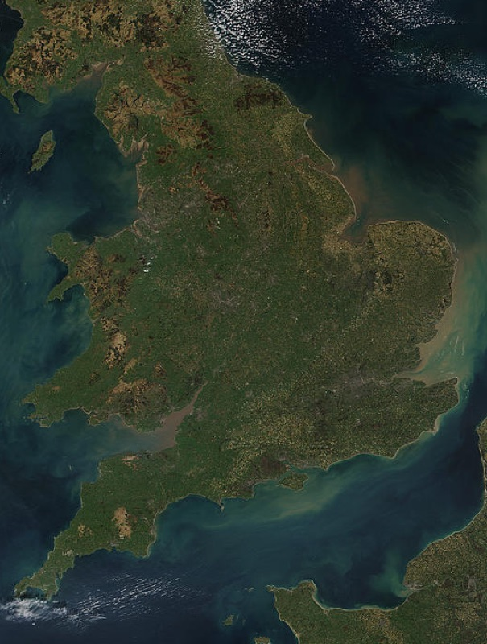

---
id    = "1a2097f6-b521-5105-b517-84268985ee0a"
model = "Basic"
tags  = ["europe", "country"]
---

## Front

<b>London</b> is the capital of which country or territory?

## Back

<b>England</b>

## Extra

<i>Photo: Jacques Descloitres, MODIS Land Rapid Response Team, NASA/GSFC, Public domain, via Wikimedia Commons</i>

About 56.5 million people (2021 census), 84% of the United Kingdom's Highest point: Scafell Pike

Named after the Angles, a Germanic tribe who settled in the 5th and 6th centuries. The Industrial Revolution began here in the 18th century.

Constituent country of the United Kingdom.

<a href="https://en.wikipedia.org/wiki/England">England on Wikipedia</a> <a href="https://en.wikipedia.org/wiki/London">London on Wikipedia</a>
