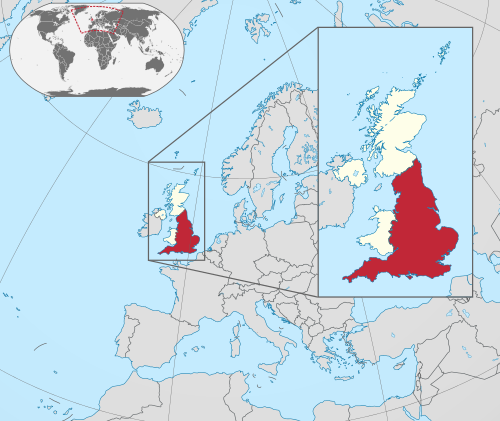

---
id    = "45084ace-2ef8-5e96-8f55-093dfdd69942"
model = "Basic"
tags  = ["europe", "map"]
---

## Front

What is highlighted on this map?

## Back

<b>England</b>

## Extra

Constituent country of the United Kingdom.

<a href="https://en.wikipedia.org/wiki/England">England on Wikipedia</a>
