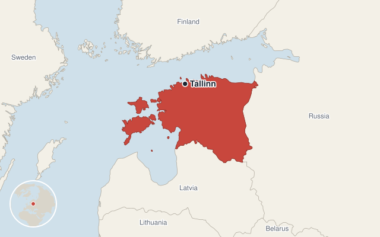

---
id    = "7bb78628-0880-52a4-bf37-abbc0e3f20c2"
model = "Basic"
tags  = ["europe", "european_union", "sovereign_state", "capital"]
---

## Front

What is the capital of <b>Estonia</b>?

## Back

<b>Tallinn</b>

## Extra

<a href="https://en.wikipedia.org/wiki/Tallinn">Tallinn on Wikipedia</a> <a href="https://en.wikipedia.org/wiki/Estonia">Estonia on Wikipedia</a>
