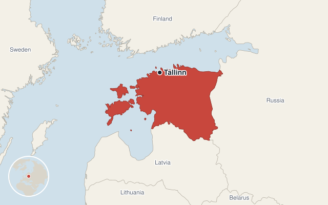

---
id    = "41fac657-e83e-5ace-9495-b0b2661e2884"
model = "Basic"
tags  = ["europe", "european_union", "sovereign_state", "country"]
---

## Front

<b>Tallinn</b> is the capital of which country or territory?

## Back

<b>Estonia</b>

## Extra

About 1.4 million people (2025) Highest point: Suur Munamägi

Present-day Estonia has been inhabited since at least 9,000 BC. It is one of the least populous member states of the European Union.

<a href="https://en.wikipedia.org/wiki/Estonia">Estonia on Wikipedia</a> <a href="https://en.wikipedia.org/wiki/Tallinn">Tallinn on Wikipedia</a>
