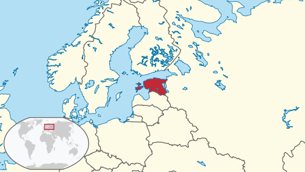

---
id    = "9e0ae92c-07bc-5651-8bfb-8e413d94ebef"
model = "Basic"
tags  = ["europe", "european_union", "sovereign_state", "map"]
---

## Front

What is highlighted on this map?

## Back

<b>Estonia</b>
