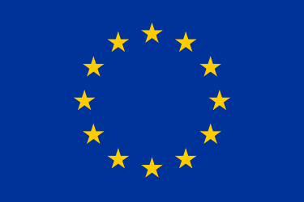

---
id    = "70cbddf9-cc7f-50ab-8fa0-d0df9ab0b89a"
model = "Basic"
tags  = ["europe", "flag"]
---

## Front

Whose flag is this?

## Back

<b>European Union</b>

## Extra

Adopted by the Council of Europe in 1955, by the EU since 1985

Twelve golden stars in a circle on a navy blue field. The flag has no status in any of the EU's treaties: a plan to make it an official symbol was part of a constitution treaty that failed to be ratified.

<a href="https://en.wikipedia.org/wiki/Flag_of_Europe">Flag of Europe on Wikipedia</a> <a href="https://en.wikipedia.org/wiki/European_Union">European Union on Wikipedia</a>
