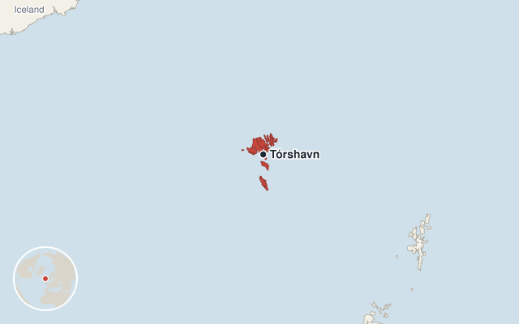

---
id    = "f223d6df-ae63-5e42-90c8-45ebc8331f08"
model = "Basic"
tags  = ["europe", "capital"]
---

## Front

What is the capital of <b>Faroe Islands</b>?

## Back

<b>Tórshavn</b>

## Extra

Constituent country in the Kingdom of Denmark.

<a href="https://en.wikipedia.org/wiki/T%C3%B3rshavn">Tórshavn on Wikipedia</a> <a href="https://en.wikipedia.org/wiki/Faroe_Islands">Faroe Islands on Wikipedia</a>
