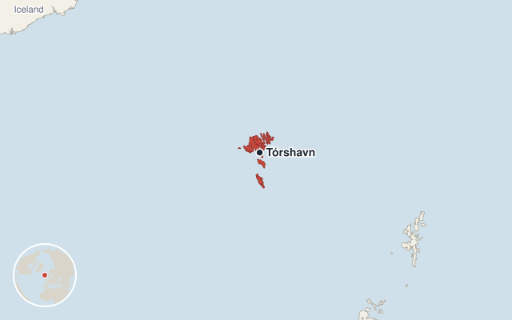
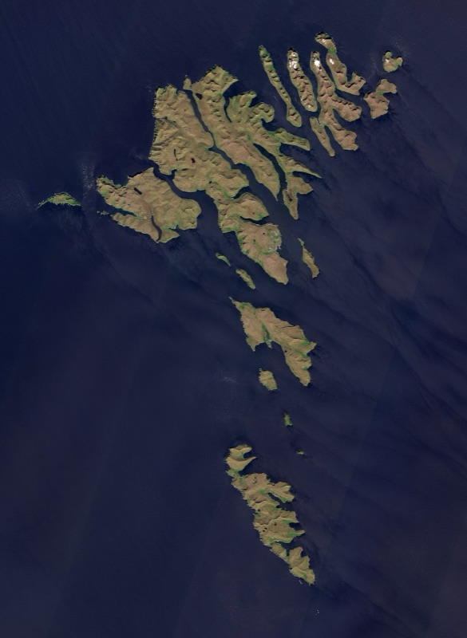

---
id    = "b7d782ea-ce67-50a9-81ef-15ed399f0cc7"
model = "Basic"
tags  = ["europe", "country"]
---

## Front

<b>Tórshavn</b> is the capital of which country or territory?

## Back

<b>Faroe Islands</b>

## Extra

<i>Photo: Copernicus Sentinel-2, ESA, CC BY-SA 3.0 igo, via Wikimedia Commons</i>

About 54,000 people (2023), land area about 1,400 km2 Highest point: Slættaratindur

The most widely held theory reads the name as "sheep islands". The capital receives the fewest hours of sunshine of any city in the world, only 840 hours per year.

Constituent country in the Kingdom of Denmark.

<a href="https://en.wikipedia.org/wiki/Faroe_Islands">Faroe Islands on Wikipedia</a> <a href="https://en.wikipedia.org/wiki/T%C3%B3rshavn">Tórshavn on Wikipedia</a>
