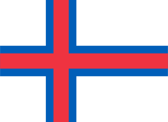

---
id    = "24c99066-84ce-5d9c-a97b-c69190138b8d"
model = "Basic"
tags  = ["europe", "flag"]
---

## Front

Whose flag is this?

## Back

<b>Faroe Islands</b>

## Extra

Similar flags: Iceland (blue background, red and white cross), Norway (red background, blue and white cross)  Constituent country in the Kingdom of Denmark.
