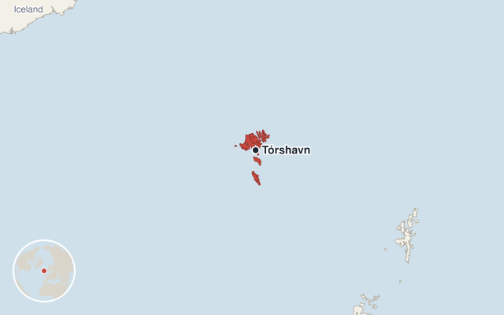

---
id    = "24c99066-84ce-5d9c-a97b-c69190138b8d"
model = "Basic"
tags  = ["europe", "flag"]
---

## Front

Whose flag is this?

## Back

<b>Faroe Islands</b>

## Extra

First hoisted on 22 June 1919, recognised by Britain on 25 April 1940

Called Merkið, "the banner": a red Nordic cross outlined in blue on white. Faroese students in Copenhagen designed it in 1919, and 25 April is Flag Day.

Similar flags: Iceland (blue background, red and white cross), Norway (red background, blue and white cross)  Constituent country in the Kingdom of Denmark.

<a href="https://en.wikipedia.org/wiki/Flag_of_the_Faroe_Islands">Flag of the Faroe Islands on Wikipedia</a> <a href="https://en.wikipedia.org/wiki/Faroe_Islands">Faroe Islands on Wikipedia</a>
