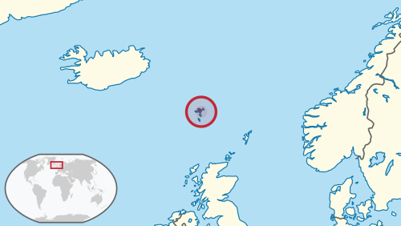
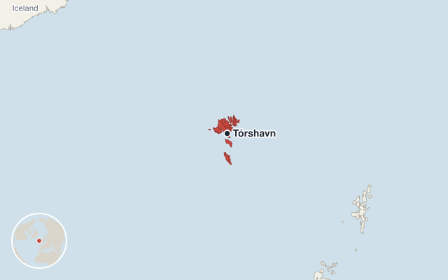

---
id    = "1fcccb6f-4fe2-5727-a823-86f03d0260bf"
model = "Basic"
tags  = ["europe", "map"]
---

## Front

What is highlighted on this map?

## Back

<b>Faroe Islands</b>

## Extra

An archipelago in the North Atlantic, between Iceland, Norway and Scotland Part of the Kingdom of Denmark, with home rule

The terrain is rugged, dominated by fjords and cliffs with sparse vegetation and few trees.

Constituent country in the Kingdom of Denmark.

<a href="https://en.wikipedia.org/wiki/Faroe_Islands">Faroe Islands on Wikipedia</a>
