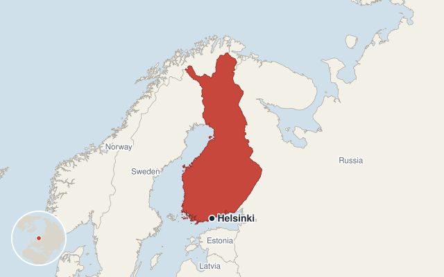

---
id    = "7501f2f1-24c6-5444-8e6a-5fe3c16c04df"
model = "Basic"
tags  = ["europe", "european_union", "sovereign_state", "capital"]
---

## Front

What is the capital of <b>Finland</b>?

## Back

<b>Helsinki</b>

## Extra

About 694,000 people (2025) On the Gulf of Finland, 80 km north of Tallinn

Known in English as Helsingfors, its Swedish name, until about 1930. It is the northernmost capital of an EU member state, and a bilingual municipality in Finnish and Swedish.

<a href="https://en.wikipedia.org/wiki/Helsinki">Helsinki on Wikipedia</a> <a href="https://en.wikipedia.org/wiki/Finland">Finland on Wikipedia</a>
