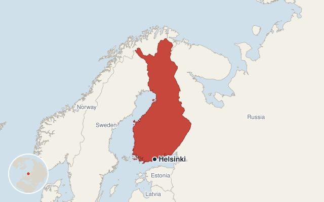

---
id    = "52f64680-2c34-5bd5-ba95-ba6b1c65acbe"
model = "Basic"
tags  = ["europe", "european_union", "sovereign_state", "country"]
---

## Front

<b>Helsinki</b> is the capital of which country or territory?

## Back

<b>Finland</b>

## Extra

About 5.7 million people (2025) Highest point: Halti

Predominantly covered by boreal forest, with over 180,000 recorded lakes. Off its coast lies the world's largest archipelago, with more than 50,000 islands.

<a href="https://en.wikipedia.org/wiki/Finland">Finland on Wikipedia</a> <a href="https://en.wikipedia.org/wiki/Helsinki">Helsinki on Wikipedia</a>
