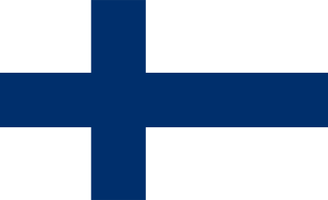
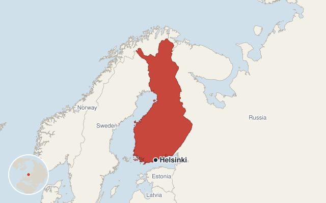

---
id    = "e5cc9e27-30a9-552c-b282-b2f0543771ec"
model = "Basic"
tags  = ["europe", "european_union", "sovereign_state", "flag"]
---

## Front

Whose flag is this?

## Back

<b>Finland</b>

## Extra

Adopted after independence in 1918

Called the siniristilippu, the Blue Cross Flag. Blue is said to represent the country's thousands of lakes and the sky, and white the snow that covers the land in winter.

<a href="https://en.wikipedia.org/wiki/Flag_of_Finland">Flag of Finland on Wikipedia</a> <a href="https://en.wikipedia.org/wiki/Finland">Finland on Wikipedia</a>
