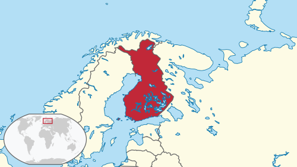
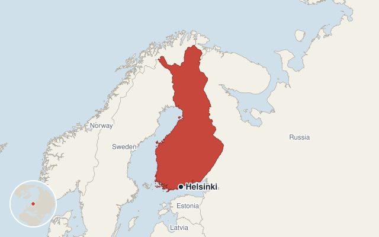

---
id    = "fae3670b-fbba-5e7c-95a4-9cb3cce0d67d"
model = "Basic"
tags  = ["europe", "european_union", "sovereign_state", "map"]
---

## Front

What is highlighted on this map?

## Back

<b>Finland</b>

## Extra

<a href="https://en.wikipedia.org/wiki/Finland">Finland on Wikipedia</a>
