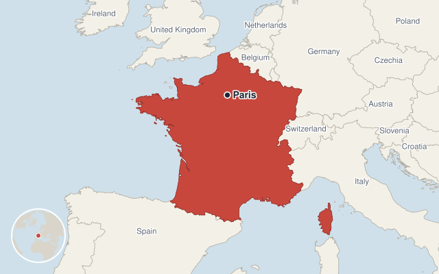

---
id    = "f74b4e79-4be7-56fd-a685-e73999ff5cad"
model = "Basic"
tags  = ["europe", "european_union", "mediterranean", "sovereign_state", "capital"]
---

## Front

What is the capital of <b>France</b>?

## Back

<b>Paris</b>

## Extra

<a href="https://en.wikipedia.org/wiki/Paris">Paris on Wikipedia</a> <a href="https://en.wikipedia.org/wiki/France">France on Wikipedia</a>
