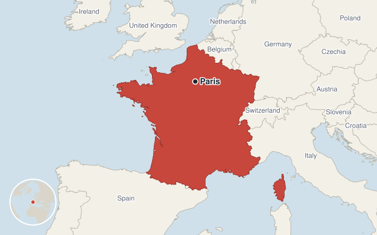

---
id    = "6b330969-c39b-53e6-9b4b-eb040941b4cc"
model = "Basic"
tags  = ["europe", "european_union", "mediterranean", "sovereign_state", "country"]
---

## Front

<b>Paris</b> is the capital of which country or territory?

## Back

<b>France</b>

## Extra

<a href="https://en.wikipedia.org/wiki/France">France on Wikipedia</a> <a href="https://en.wikipedia.org/wiki/Paris">Paris on Wikipedia</a>
