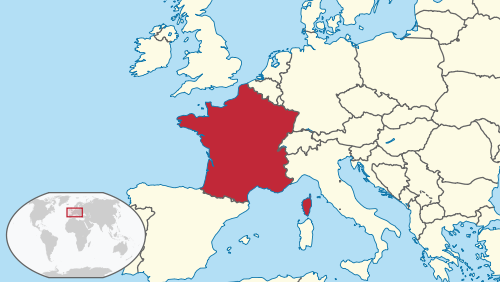
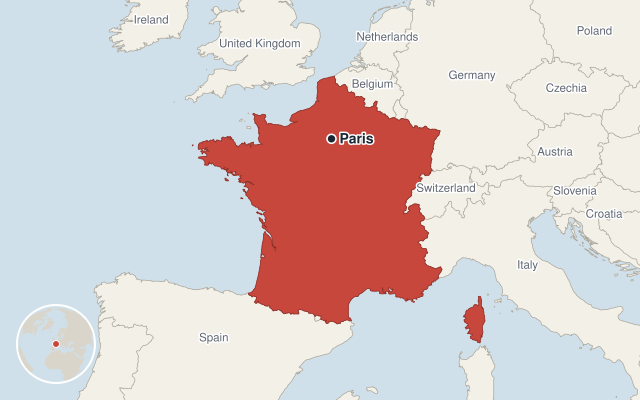

---
id    = "45512201-1419-5192-b9fe-efa57606a1d0"
model = "Basic"
tags  = ["europe", "european_union", "mediterranean", "sovereign_state", "map"]
---

## Front

What is highlighted on this map?

## Back

<b>France</b>

## Extra

Metropolitan France borders Belgium, Luxembourg, Germany, Switzerland, Italy, Monaco, Andorra and Spain About 643,800 km2 including overseas regions

The mainland runs from the Rhine to the Atlantic Ocean and from the Mediterranean Sea to the English Channel and the North Sea.

<a href="https://en.wikipedia.org/wiki/France">France on Wikipedia</a>
