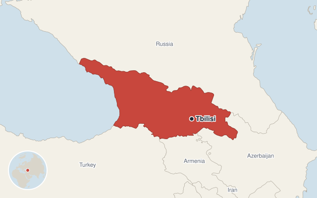
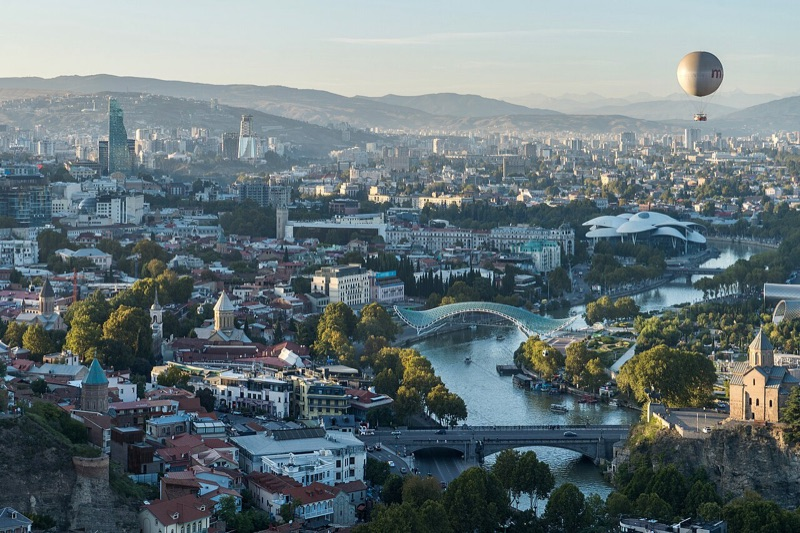

---
id    = "4e3fb1dd-d37d-5ec1-ade9-39a1300d267a"
model = "Basic"
tags  = ["europe", "sovereign_state", "capital"]
---

## Front

What is the capital of <b>Georgia</b>?

## Back

<b>Tbilisi</b>

## Extra

<i>Photo: Alexey Komarov, CC BY-SA 4.0, via Wikimedia Commons</i>

About 1.3 million people (2024), almost a third of the country's On the banks of the Kura River, 575 m above sea level

Founded in the 5th century by Vakhtang I of Iberia. The name means "place of warmth", given for the area's many sulfuric hot springs.

<a href="https://en.wikipedia.org/wiki/Tbilisi">Tbilisi on Wikipedia</a> <a href="https://en.wikipedia.org/wiki/Georgia_(country)">Georgia on Wikipedia</a>
