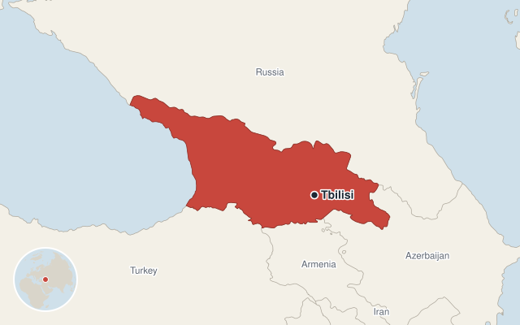

---
id    = "83a3e17e-6768-502f-9787-14bf340605a7"
model = "Basic"
tags  = ["europe", "sovereign_state", "country"]
---

## Front

<b>Tbilisi</b> is the capital of which country or territory?

## Back

<b>Georgia</b>

## Extra

<a href="https://en.wikipedia.org/wiki/Georgia_(country)">Georgia on Wikipedia</a> <a href="https://en.wikipedia.org/wiki/Tbilisi">Tbilisi on Wikipedia</a>
