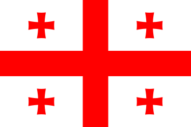
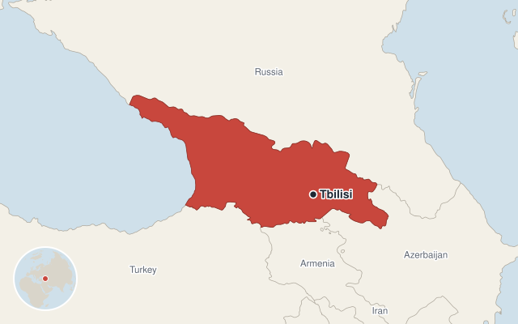

---
id    = "82c060a5-09f5-5336-aafd-8897a80add24"
model = "Basic"
tags  = ["europe", "sovereign_state", "flag"]
---

## Front

Whose flag is this?

## Back

<b>Georgia</b>

## Extra

Reinstated as the national flag in 2004

Called the Five-Cross Flag: a medieval banner of the Kingdom of Georgia. The five crosses are sometimes read as the Five Holy Wounds, or as Christ and the Four Evangelists.

<a href="https://en.wikipedia.org/wiki/Flag_of_Georgia_(country)">Flag of Georgia on Wikipedia</a> <a href="https://en.wikipedia.org/wiki/Georgia_(country)">Georgia on Wikipedia</a>
