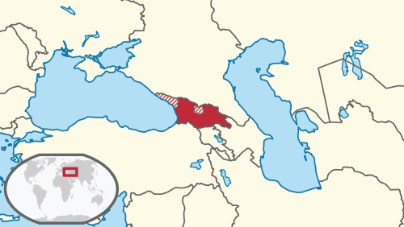
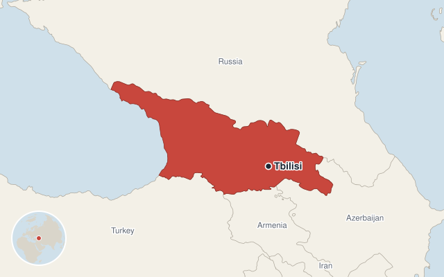

---
id    = "ae889131-2815-54f3-b98f-d95b55835150"
model = "Basic"
tags  = ["europe", "sovereign_state", "map"]
---

## Front

What is highlighted on this map?

## Back

<b>Georgia</b>

## Extra

Borders Russia, Turkey, Armenia and Azerbaijan The Black Sea lies to the west

It sits in the Caucasus at the intersection of Eastern Europe and West Asia, and is generally regarded as part of Europe.

<a href="https://en.wikipedia.org/wiki/Georgia_(country)">Georgia on Wikipedia</a>
