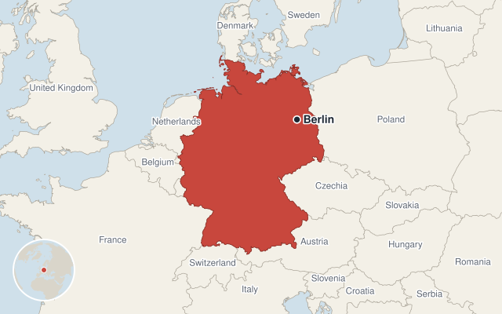
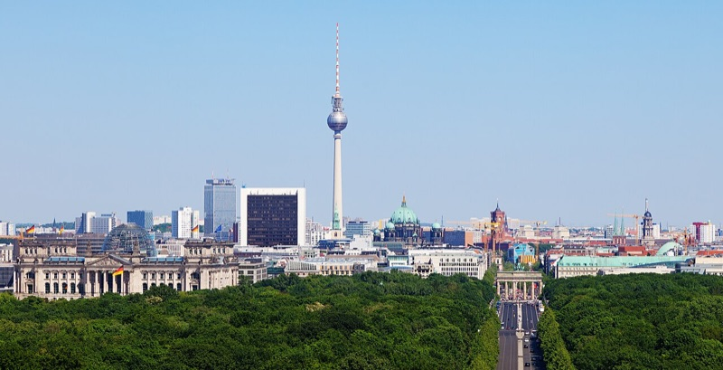

---
id    = "1fbe5b36-0012-5cef-975f-38d8d95deea4"
model = "Basic"
tags  = ["europe", "european_union", "sovereign_state", "capital"]
---

## Front

What is the capital of <b>Germany</b>?

## Back

<b>Berlin</b>

## Extra

<i>Photo: Thomas Wolf, www.foto-tw.de, Thomas Wolf, www.foto-tw.de, via Wikimedia Commons</i>

About 3.9 million people (2025), the most of any city in the EU 34 m above sea level, surrounded by the state of Brandenburg

First documented in the 13th century, at the crossing of two important trade routes. It has been the capital of Prussia, the German Empire and the Weimar Republic.

<a href="https://en.wikipedia.org/wiki/Berlin">Berlin on Wikipedia</a> <a href="https://en.wikipedia.org/wiki/Germany">Germany on Wikipedia</a>
