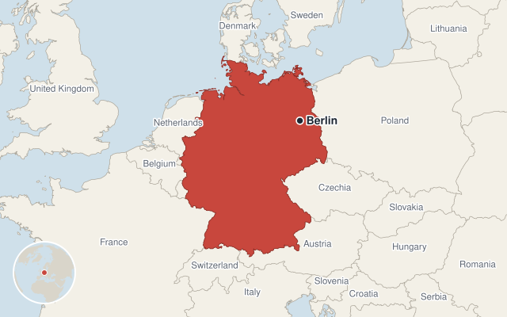

---
id    = "92a2232e-7dc2-5211-b03c-0b5c7c3a482b"
model = "Basic"
tags  = ["europe", "european_union", "sovereign_state", "country"]
---

## Front

<b>Berlin</b> is the capital of which country or territory?

## Back

<b>Germany</b>

## Extra

About 83.5 million people (2025), the most in the EU Highest point: Zugspitze

Its 16 constituent states make it the most populous member state of the European Union. It has the third-highest number of UNESCO World Heritage Sites, 55.

<a href="https://en.wikipedia.org/wiki/Germany">Germany on Wikipedia</a> <a href="https://en.wikipedia.org/wiki/Berlin">Berlin on Wikipedia</a>
