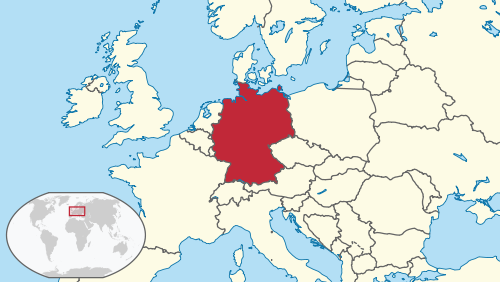
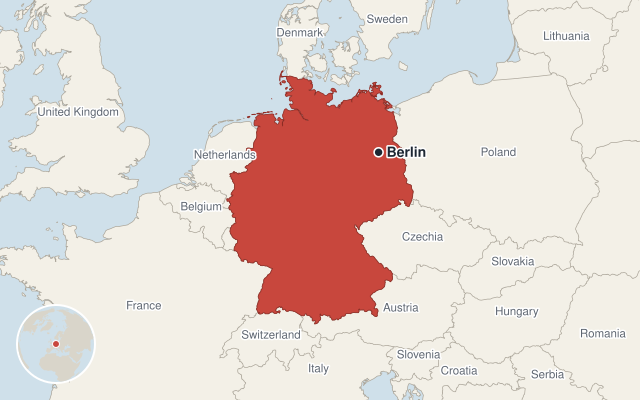

---
id    = "610d5fd7-b86a-5c40-a24d-01d5c9b7f5e5"
model = "Basic"
tags  = ["europe", "european_union", "sovereign_state", "map"]
---

## Front

What is highlighted on this map?

## Back

<b>Germany</b>

## Extra

<a href="https://en.wikipedia.org/wiki/Germany">Germany on Wikipedia</a>
