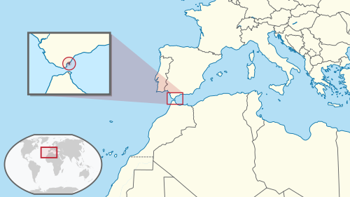

---
id    = "f9596728-191e-5845-a1c3-57ee328f0d99"
model = "Basic"
tags  = ["europe", "mediterranean", "map"]
---

## Front

What is highlighted on this map?

## Back

<b>Gibraltar</b>

## Extra

Overseas territory of the United Kingdom.

<a href="https://en.wikipedia.org/wiki/Gibraltar">Gibraltar on Wikipedia</a>
