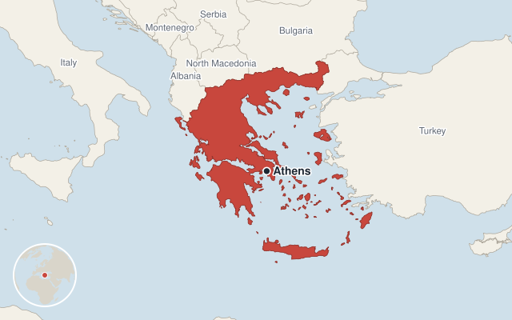

---
id    = "47f9deae-5182-56d5-a104-f1c88152f2c6"
model = "Basic"
tags  = ["europe", "european_union", "mediterranean", "sovereign_state", "capital"]
---

## Front

What is the capital of <b>Greece</b>?

## Back

<b>Athens</b>

## Extra

<a href="https://en.wikipedia.org/wiki/Athens">Athens on Wikipedia</a> <a href="https://en.wikipedia.org/wiki/Greece">Greece on Wikipedia</a>
