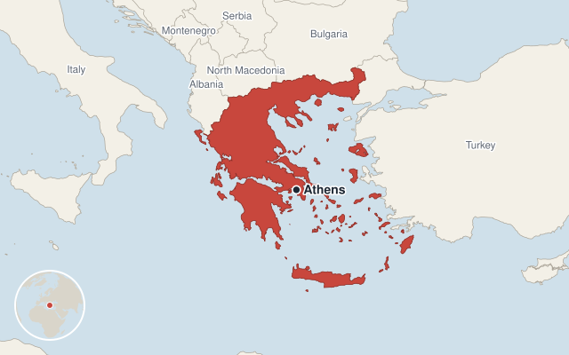

---
id    = "7506fd6c-460a-5022-83a2-95ff2a5db391"
model = "Basic"
tags  = ["europe", "european_union", "mediterranean", "sovereign_state", "country"]
---

## Front

<b>Athens</b> is the capital of which country or territory?

## Back

<b>Greece</b>

## Extra

<a href="https://en.wikipedia.org/wiki/Greece">Greece on Wikipedia</a> <a href="https://en.wikipedia.org/wiki/Athens">Athens on Wikipedia</a>
