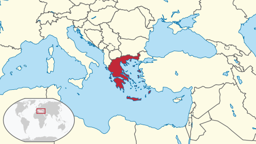
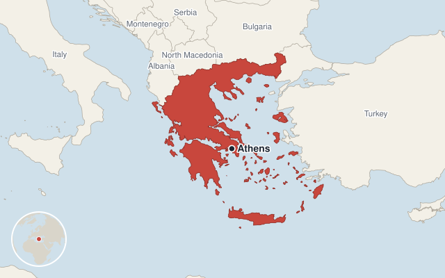

---
id    = "ac8c7483-53cd-5373-81d5-9b436108d1c8"
model = "Basic"
tags  = ["europe", "european_union", "mediterranean", "sovereign_state", "map"]
---

## Front

What is highlighted on this map?

## Back

<b>Greece</b>

## Extra

<a href="https://en.wikipedia.org/wiki/Greece">Greece on Wikipedia</a>
