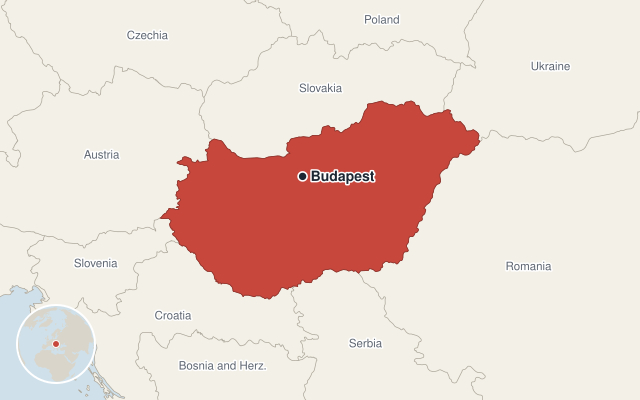

---
id    = "b269def3-5897-543e-9a79-7f2053617bfe"
model = "Basic"
tags  = ["europe", "european_union", "sovereign_state", "capital"]
---

## Front

What is the capital of <b>Hungary</b>?

## Back

<b>Budapest</b>

## Extra

About 1.7 million people (2026), 117 m above sea level On the Danube, in the centre of the Pannonian Basin

Home to about a third of the country's population, it produces more than 40% of its economic output.

<a href="https://en.wikipedia.org/wiki/Budapest">Budapest on Wikipedia</a> <a href="https://en.wikipedia.org/wiki/Hungary">Hungary on Wikipedia</a>
