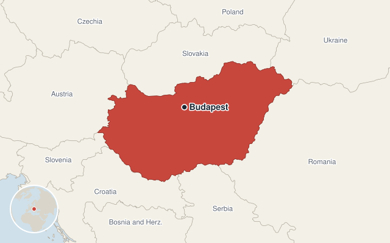

---
id    = "61ebd00d-3b3a-5ea9-9565-253d07a7e39c"
model = "Basic"
tags  = ["europe", "european_union", "sovereign_state", "country"]
---

## Front

<b>Budapest</b> is the capital of which country or territory?

## Back

<b>Hungary</b>

## Extra

<a href="https://en.wikipedia.org/wiki/Hungary">Hungary on Wikipedia</a> <a href="https://en.wikipedia.org/wiki/Budapest">Budapest on Wikipedia</a>
