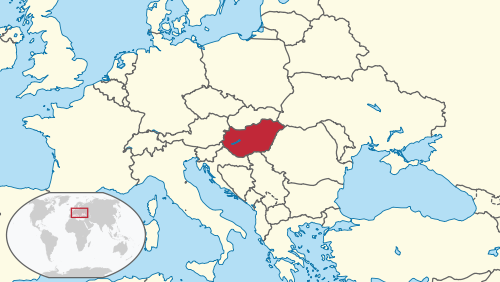

---
id    = "dfb942f5-320e-5d45-a975-a42fedc339d5"
model = "Basic"
tags  = ["europe", "european_union", "sovereign_state", "map"]
---

## Front

What is highlighted on this map?

## Back

<b>Hungary</b>
