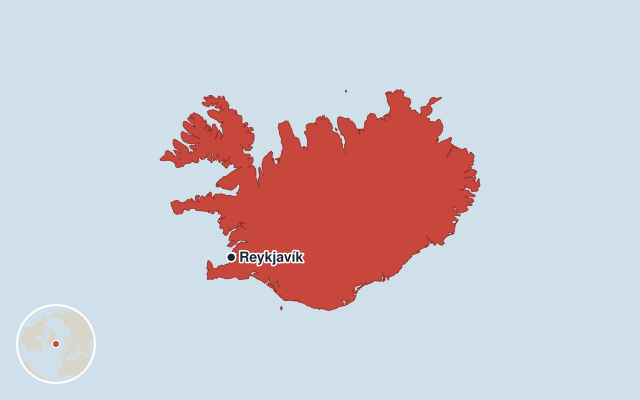

---
id    = "4df7a5dc-3074-5ce0-bcd3-0fd9a97155a7"
model = "Basic"
tags  = ["europe", "sovereign_state", "capital"]
---

## Front

What is the capital of <b>Iceland</b>?

## Back

<b>Reykjavík</b>

## Extra

<a href="https://en.wikipedia.org/wiki/Reykjav%C3%ADk">Reykjavík on Wikipedia</a> <a href="https://en.wikipedia.org/wiki/Iceland">Iceland on Wikipedia</a>
