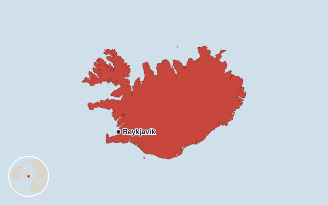
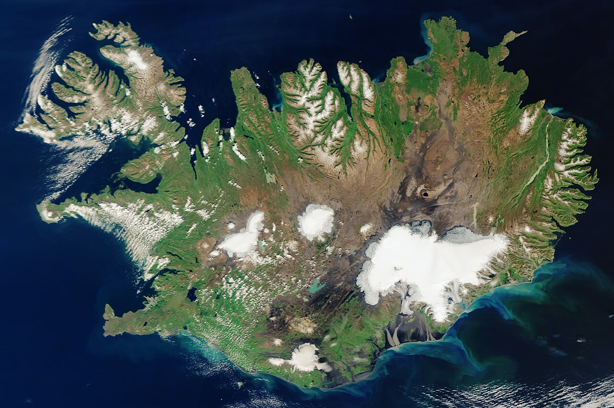

---
id    = "e666bf99-d415-576b-8160-f40fed659ef9"
model = "Basic"
tags  = ["europe", "sovereign_state", "country"]
---

## Front

<b>Reykjavík</b> is the capital of which country or territory?

## Back

<b>Iceland</b>

## Extra

<i>Photo: Contains modified Copernicus Sentinel data 2020, European Space Agency, via Wikimedia Commons</i>

About 376,000 people (2022), roughly a third of them in Reykjavík Highest point: Hvannadalshnúkur

Iceland sits on a rift between tectonic plates, which is why it has geysers and frequent eruptions. Its parliament, the Althing, dates from around 930 and is one of the world's oldest.

<a href="https://en.wikipedia.org/wiki/Iceland">Iceland on Wikipedia</a> <a href="https://en.wikipedia.org/wiki/Reykjav%C3%ADk">Reykjavík on Wikipedia</a>
