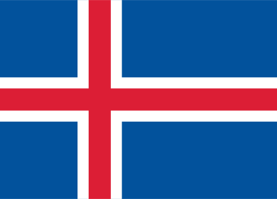

---
id    = "aec83c04-6b4a-5607-a668-cea059018f83"
model = "Basic"
tags  = ["europe", "sovereign_state", "flag"]
---

## Front

Whose flag is this?

## Back

<b>Iceland</b>

## Extra

Similar flags: Norway (red background, blue cross), Faroe Islands (white background, red and blue cross)
