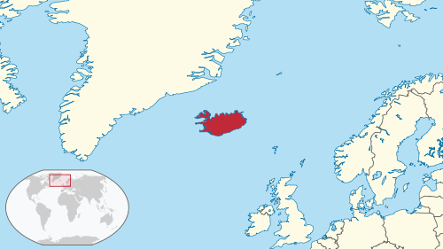
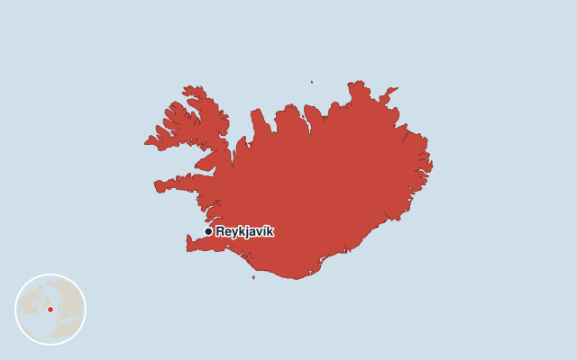

---
id    = "8988c1e4-e147-5f47-83c3-a666f30b64ad"
model = "Basic"
tags  = ["europe", "sovereign_state", "map"]
---

## Front

What is highlighted on this map?

## Back

<b>Iceland</b>

## Extra

<a href="https://en.wikipedia.org/wiki/Iceland">Iceland on Wikipedia</a>
