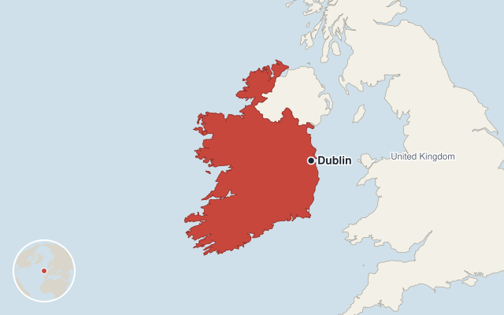

---
id    = "27c814a6-9d0d-51eb-bed5-a9b4f6f0c77c"
model = "Basic"
tags  = ["europe", "european_union", "sovereign_state", "capital"]
---

## Front

What is the capital of <b>Ireland</b>?

## Back

<b>Dublin</b>

## Extra

<a href="https://en.wikipedia.org/wiki/Dublin">Dublin on Wikipedia</a> <a href="https://en.wikipedia.org/wiki/Republic_of_Ireland">Republic of Ireland on Wikipedia</a>
