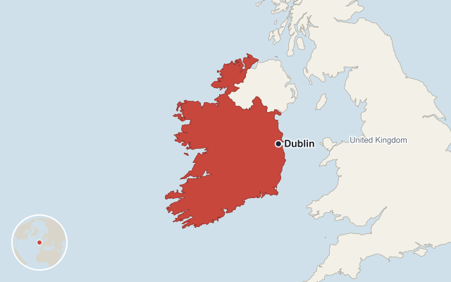

---
id    = "cfa96a63-16a9-515a-b327-da52a8c938d4"
model = "Basic"
tags  = ["europe", "european_union", "sovereign_state", "country"]
---

## Front

<b>Dublin</b> is the capital of which country or territory?

## Back

<b>Ireland</b>

## Extra

<a href="https://en.wikipedia.org/wiki/Republic_of_Ireland">Republic of Ireland on Wikipedia</a> <a href="https://en.wikipedia.org/wiki/Dublin">Dublin on Wikipedia</a>
