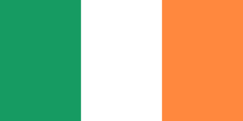
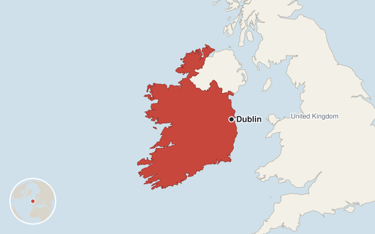

---
id    = "eebc7f33-0abd-5292-ae6f-26cb6ee66e3b"
model = "Basic"
tags  = ["europe", "european_union", "sovereign_state", "flag"]
---

## Front

Whose flag is this?

## Back

<b>Ireland</b>

## Extra

Adopted by the Irish Republic during the War of Independence (1919 to 1921)

Green stands for Roman Catholics and orange for Protestants, with white between for a lasting truce. It came to be regarded as the national flag after the 1916 Easter Rising.

Similar flags: Ivory Coast (green and orange flipped, narrower)

<a href="https://en.wikipedia.org/wiki/Flag_of_Ireland">Flag of Ireland on Wikipedia</a> <a href="https://en.wikipedia.org/wiki/Republic_of_Ireland">Republic of Ireland on Wikipedia</a>
