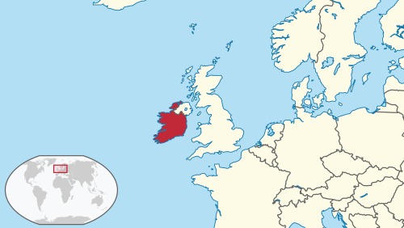

---
id    = "4a5bf527-177a-5539-951c-844614d0e571"
model = "Basic"
tags  = ["europe", "european_union", "sovereign_state", "map"]
---

## Front

What is highlighted on this map?

## Back

<b>Ireland</b>
