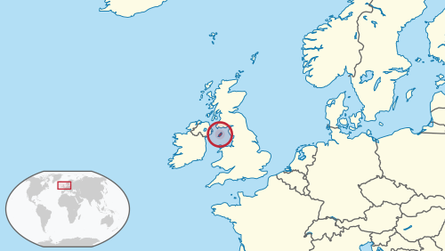

---
id    = "d6ab6c92-476c-5ef5-9667-34fabc33f6d3"
model = "Basic"
tags  = ["europe", "map"]
---

## Front

What is highlighted on this map?

## Back

<b>Isle of Man</b>

## Extra

About 572 km2, about 84,500 people (2024) Highest point: Snaefell

A self-governing British Crown Dependency in the Irish Sea, between Great Britain and Ireland. Its parliament, Tynwald, was the first national legislature in the world to give women the vote in a general election, in 1881.

Crown dependency of the United Kingdom.

<a href="https://en.wikipedia.org/wiki/Isle_of_Man">Isle of Man on Wikipedia</a>
