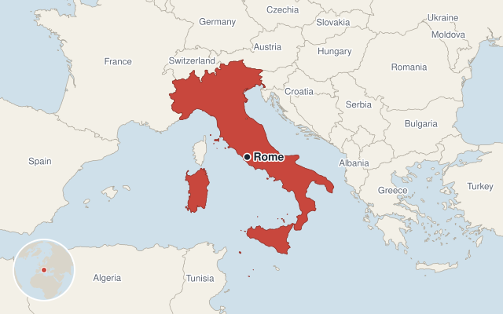

---
id    = "4a3d43e9-e8a4-5c9d-ab8e-39c49a0f725b"
model = "Basic"
tags  = ["europe", "european_union", "mediterranean", "sovereign_state", "capital"]
---

## Front

What is the capital of <b>Italy</b>?

## Back

<b>Rome</b>

## Extra

<a href="https://en.wikipedia.org/wiki/Rome">Rome on Wikipedia</a> <a href="https://en.wikipedia.org/wiki/Italy">Italy on Wikipedia</a>
