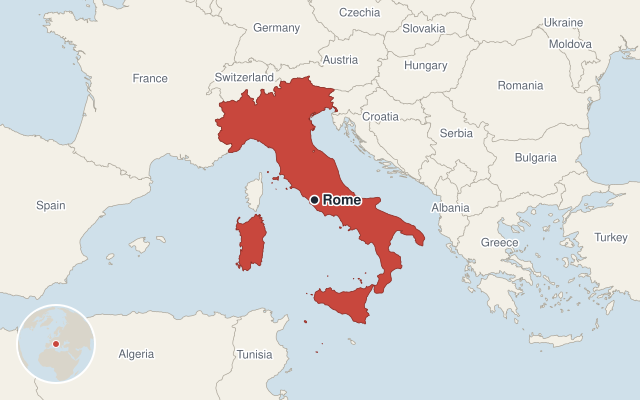

---
id    = "62973f02-62d7-5b14-aa5c-51d992c4aad0"
model = "Basic"
tags  = ["europe", "european_union", "mediterranean", "sovereign_state", "country"]
---

## Front

<b>Rome</b> is the capital of which country or territory?

## Back

<b>Italy</b>

## Extra

About 58.9 million people (2023), third in the EU Highest point: Mont Blanc

Nearly 800 islands belong to it, notably Sicily and Sardinia. The Vatican City and San Marino are two enclaves within its borders.

<a href="https://en.wikipedia.org/wiki/Italy">Italy on Wikipedia</a> <a href="https://en.wikipedia.org/wiki/Rome">Rome on Wikipedia</a>
