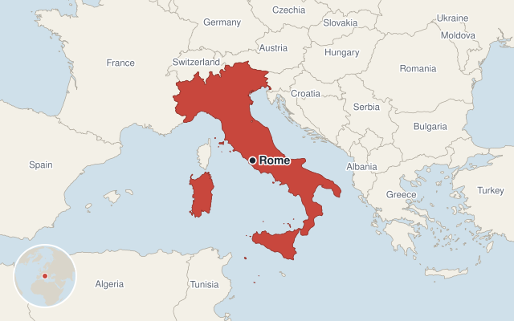

---
id    = "ffe24323-5582-51a1-971f-9ffd58a15794"
model = "Basic"
tags  = ["europe", "european_union", "mediterranean", "sovereign_state", "flag"]
---

## Front

Whose flag is this?

## Back

<b>Italy</b>

## Extra

<a href="https://en.wikipedia.org/wiki/Flag_of_Italy">Flag of Italy on Wikipedia</a> <a href="https://en.wikipedia.org/wiki/Italy">Italy on Wikipedia</a>
