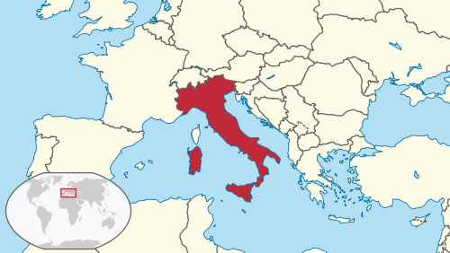
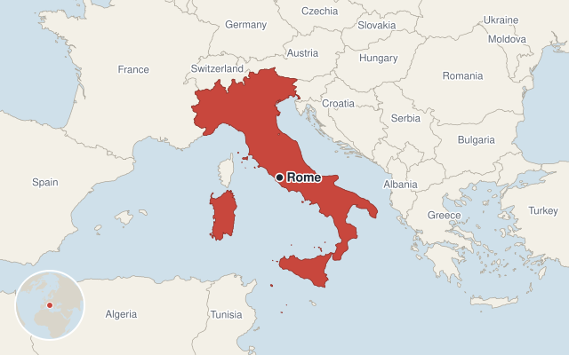

---
id    = "f40e1453-d3c4-5fb0-852f-29047202e561"
model = "Basic"
tags  = ["europe", "european_union", "mediterranean", "sovereign_state", "map"]
---

## Front

What is highlighted on this map?

## Back

<b>Italy</b>

## Extra

A peninsula in the Mediterranean, about 302,000 km2 Land borders with France, Switzerland, Austria and Slovenia

The Alps form its northern land border. It is the tenth-largest country in Europe by area.

<a href="https://en.wikipedia.org/wiki/Italy">Italy on Wikipedia</a>
