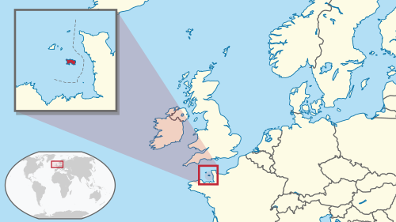
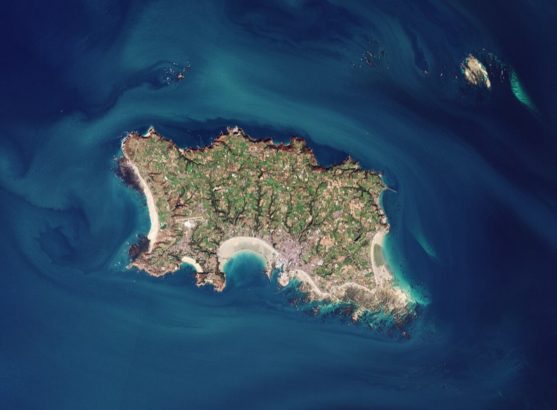

---
id    = "4562199b-f835-5524-8526-345992fa3d26"
model = "Basic"
tags  = ["europe", "map"]
---

## Front

What is highlighted on this map?

## Back

<b>Jersey</b>

## Extra

<i>Photo: Copernicus Sentinel-2, ESA, CC BY-SA 3.0 igo, via Wikimedia Commons</i>

About 118 km2, 103,000 people (2021 census) 23 km off the Cotentin Peninsula of France

The largest of the Channel Islands. A self-governing Crown Dependency, it has never been part of the Kingdom of England, having remained loyal to the English Crown when the kings lost mainland Normandy.

Crown dependency of the United Kingdom.

<a href="https://en.wikipedia.org/wiki/Jersey">Jersey on Wikipedia</a>
