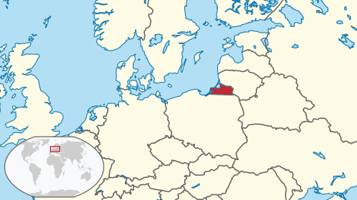
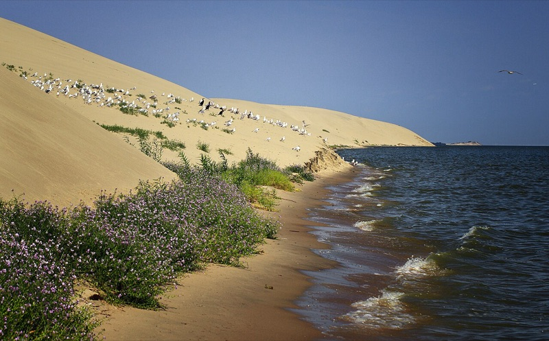

---
id    = "bc567e39-3982-53d0-b371-2903d55c7cb6"
model = "Basic"
tags  = ["europe", "map"]
---

## Front

What is highlighted on this map?

## Back

<b>Kaliningrad Oblast</b>

## Extra

<i>Photo: Marina Torgashova, CC BY-SA 4.0, via Wikimedia Commons</i>

About 15,100 km2, about 1 million people (2021 census) Borders Poland to the south and Lithuania to the north and east

A semi-exclave of Russia on the Baltic Sea. Baltiysk is Russia's only Baltic port that remains ice-free in winter.

Oblast (administrative region) of the Russian Federation.

<a href="https://en.wikipedia.org/wiki/Kaliningrad_Oblast">Kaliningrad Oblast on Wikipedia</a>
