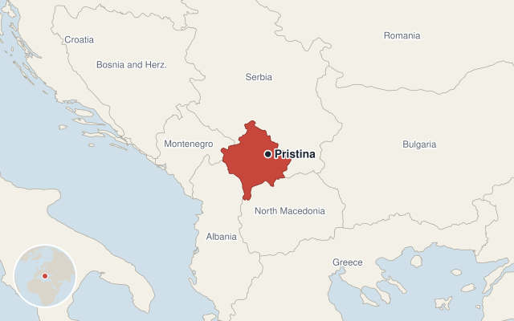

---
id    = "c3f7b65a-8d0c-510b-892c-0cd6236bf43e"
model = "Basic"
tags  = ["europe", "sovereign_state", "capital"]
---

## Front

What is the capital of <b>Kosovo</b>?

## Back

<b>Pristina</b>

## Extra

Partially recognised state claimed by Serbia.

<a href="https://en.wikipedia.org/wiki/Pristina">Pristina on Wikipedia</a> <a href="https://en.wikipedia.org/wiki/Kosovo">Kosovo on Wikipedia</a>
