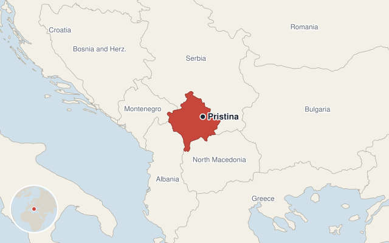

---
id    = "0508a835-0894-540c-a9d9-2e9f16f395bf"
model = "Basic"
tags  = ["europe", "sovereign_state", "country"]
---

## Front

<b>Pristina</b> is the capital of which country or territory?

## Back

<b>Kosovo</b>

## Extra

Partially recognised state claimed by Serbia.

<a href="https://en.wikipedia.org/wiki/Kosovo">Kosovo on Wikipedia</a> <a href="https://en.wikipedia.org/wiki/Pristina">Pristina on Wikipedia</a>
