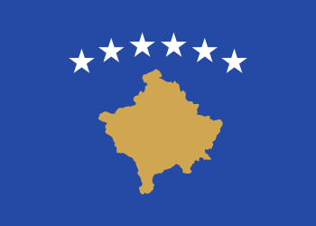

---
id    = "fa3907d3-a628-5867-81b8-fe8b5d006dbf"
model = "Basic"
tags  = ["europe", "sovereign_state", "flag"]
---

## Front

Whose flag is this?

## Back

<b>Kosovo</b>

## Extra

Partially recognised state claimed by Serbia.
